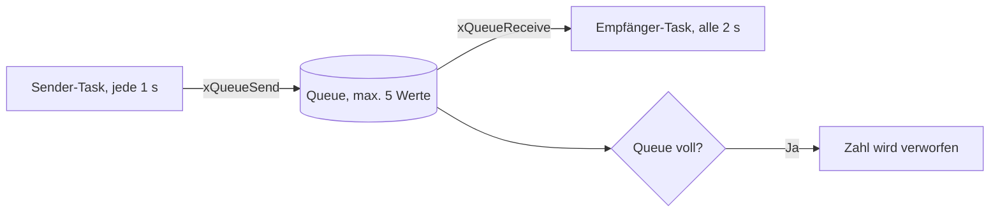

# 01 – FreeRTOS-Queues

**Lernziel:** Eine Queue puffert Zahlen, wenn der Sender schneller produziert als der Empfänger verarbeitet.

- `xQueueCreate(5, sizeof(int))` legt fünf Plätze für `int` an.
- `xQueueSend()` legt eine Zahl in die Queue oder meldet „voll“.
- `xQueueReceive()` entnimmt die nächste Zahl und wartet dabei begrenzt.

```bash
idf.py set-target esp32c6
idf.py build
idf.py -p /dev/ttyACM0 flash monitor
```

Beispiel: `gesendet: 3, Queue: 2/5` gefolgt von `empfangen: 1, Queue: 1/5`.

Ändere die Queue-Länge oder die beiden Wartezeiten und beobachte, wann „voll“ erscheint.

## Funktionsablauf


