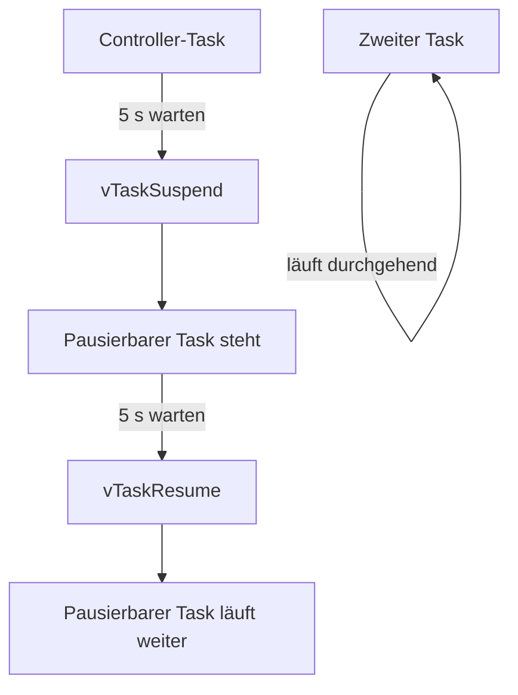

# 02 – Tasks pausieren und fortsetzen

**Lernziel:** Ein normaler Controller-Task hält einen anderen Task an und startet ihn später wieder.

- `xTaskCreate()` erzeugt Tasks und liefert über ein Handle die Referenz.
- `vTaskSuspend()` hält genau diesen Task an.
- `vTaskResume()` lässt ihn weiterlaufen; der zweite Task bleibt unbeeinflusst.

```bash
idf.py set-target esp32c6
idf.py build
idf.py -p /dev/ttyACM0 flash monitor
```

Beispiel: `pausable_task wird pausiert`, während weiter `Zweiter Task läuft weiter` erscheint; nach fünf Sekunden folgt `... fortgesetzt`.

Ändere die beiden 5000-ms-Werte oder die Task-Priorität des Controllers.

## Funktionsablauf


